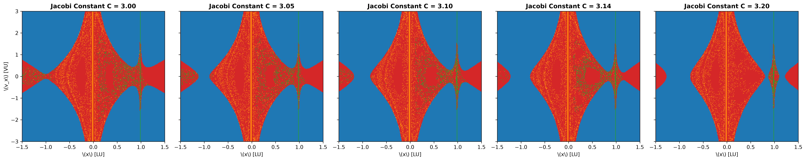

# Does ensemble-based epistemic uncertainty in a neural-network model of the planar Earth–Moon Circular Restricted Three-Body Problem exhibit power-law scaling near fractal escape and collision basin boundaries, and how does its scaling exponent compare with the classical uncertainty exponent $\alpha=D-d$?

This this the code repository of my paper, which aims to explore how trained neural parameters may hold additional information about the complexity of fractal geometry at that region of space, opening up possibilities to a wide variety of novel applicaitons. This codebase provides relevant python code for:
- Data generation
- Validation
- Finding relevant time intervals and other constants
- Ensemble Model training and evaluation

as well as providing a comprehensive worklog of the project.